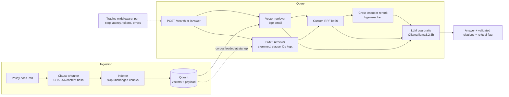

# Hybrid Retrieval & Reranking Benchmark

A compliance Q&A engine over a (synthetic) hospital policy corpus that **compares three retrieval strategies** (vector-only, hybrid BM25+vector via custom RRF, hybrid + cross-encoder reranker), benchmarks them on a hard-negative query set with separate dev/eval splits, and tests how a downstream LLM behaves on each. Everything runs locally on free, open-source components.

---

## 1. Quick start (one command)

Requires Docker Desktop. No API keys needed.

```bash
docker compose up --build
```

This starts Qdrant, Ollama (local LLM), downloads `llama3.2:3b` (~2 GB, first run only), indexes the corpus (idempotent), then serves the API on <http://localhost:8000/docs>.
The first request is slow (models load lazily); later ones are fast.

| Goal | Command |
|---|---|
| Run the full test suite (no other service needed) | `docker compose run --rm tests` |
| Run dev + eval retrieval benchmarks and Pareto plot | `docker compose run --rm benchmark` |
| Run LLM robustness test (all 3 strategies) | `docker compose run --rm llm-robustness` |
| Stop (keeps downloaded models and indexed data) | `docker compose down` |

Try the API:

```bash
curl -X POST localhost:8000/answer -H "Content-Type: application/json" \
  -d '{"query": "How often must ventilators be serviced?", "strategy": "hybrid"}'
```
`strategy` is `vector`, `hybrid`, or `hybrid_rerank`. Other endpoints: `POST /search`, `GET /health`, `GET /metrics`.

**Without Docker** (Python 3.11): `python -m venv .venv`, activate, `pip install -r requirements.txt`, run Qdrant (`docker run -p 6333:6333 qdrant/qdrant`) and Ollama, then
`QDRANT_URL=http://localhost:6333 python -m scripts.build_index` and
`QDRANT_URL=http://localhost:6333 python -m benchmark.run_benchmark --split dev`.
To use the large reranker: `RERANKER_MODEL=BAAI/bge-reranker-large`.

---

## 2. Architecture



Tier 1 = `V`; Tier 2 = `V + B → RRF`; Tier 3 = `V + B → RRF → cross-encoder`. All three implement one `Retriever` interface, so the API, benchmark and tests treat them identically.

**Vector store schema (Qdrant payload, `app/schemas.py::ChunkPayload`):** `chunk_id`, `doc_id`, `clause_id`, `section`, `text`, `source_file`, `doc_version`, `content_hash` (SHA-256 of whitespace-normalised text), `embedding_model`, `embedding_version`.
**Embedding versioning:** a chunk is re-embedded only if its `content_hash` *or* `embedding_version` changed; bump `EMBEDDING_VERSION` when the model or chunking changes. Point IDs are derived from `chunk_id`, so re-ingestion upserts and never duplicates (covered by an integration test).

### Technology trade-offs

| Choice | Why | Trade-off |
|---|---|---|
| Qdrant (Docker) | Free, explicit payloads, simple compose service | Another service to run vs. an embedded FAISS index |
| `bge-small-en-v1.5` embeddings (384-d) | Fast on CPU, free | Weaker than larger embedders |
| `rank_bm25` + Porter stemming (in-process) | Simple, transparent, clause IDs stay exact tokens | Corpus is held in memory; no incremental BM25 index |
| Custom RRF (no library) | Required by the brief; rank-based, so BM25 and cosine scales never need normalising | `k=60` untuned |
| `bge-reranker-base` / `-large` | Quality ladder to measure | Large is ~70× slower than hybrid (see results) |
| Ollama + `llama3.2:3b` | Free, no key, reproducible | Small model: weaker refusal/citation discipline (see failures) |
| OpenAI-compatible client | Swap to Groq/Gemini free tiers via `.env` only | Hosted tiers have rate limits (handled with backoff) |
| Custom tracing middleware | Per-step spans and `/metrics` with no extra infra | Not OpenTelemetry-compatible; in-process aggregates only |

---

## 3. Data and evaluation design

* **Corpus:** 10 synthetic policy documents, 64 clause-level chunks (`data/corpus/`), written to contain hard negatives (e.g. "vaccines must be stored 2–8 °C" vs "must not be stored above 8 °C"; "verbal orders may be accepted in emergencies" vs "not permitted for chemotherapy"; platelets "must not be refrigerated"), numeric thresholds and clause IDs.
* **Queries:** 22 total, graded relevance (2 = exact answer, 1 = partial). Types: exact clause, hard negative, numeric threshold, semantic paraphrase, unanswerable.
  * **Dev split** (`data/queries/dev.jsonl`): 8 queries (7 answerable). Used for tuning.
  * **Eval split** (`data/queries/eval.jsonl`): 14 queries (12 answerable). Run only after tuning; never used to choose settings.
* **Metrics** (`benchmark/metrics.py`, hand-written, unit-tested): Precision@5, Recall@5, MRR, NDCG@5 (graded gain), p50/p95 latency, cold-start latency, process RSS. Unanswerable queries are excluded from quality metrics (no relevant chunk) and tested via the LLM refusal test instead. Precision@5 is capped well below 1 because most queries have only 1–2 relevant chunks.

---

## 4. Retrieval results

Raw output: `data/results/benchmark_*.json` (per-query rankings included). Plot: `data/results/pareto.png`.
Measured on the author's CPU-only Windows machine, outside the container (`python -m benchmark.run_benchmark`), k=5. Latency is per query after the first (cold start excluded; it includes lazy model loading).

### Eval split (final numbers; 12 scored queries)

| Strategy | P@5 | R@5 | MRR | NDCG@5 | p50 ms | p95 ms | RSS MB |
|---|---|---|---|---|---|---|---|
| Vector-only | 0.217 | 0.750 | 0.750 | 0.750 | 30 | 50–62 | 667 |
| Hybrid (BM25+vector, RRF) | 0.250 | **0.917** | 0.833 | **0.855** | 32–35 | 55–65 | 668 |
| Hybrid + `bge-reranker-base` | 0.233 | 0.875 | 0.750 | 0.767 | 290 | 316 | 2171 |
| Hybrid + `bge-reranker-large` | 0.250 | **0.917** | **0.917** | **0.894** | 2190 | 2472 | 3275 |

(Vector/hybrid rows were measured in both runs; ranges show run-to-run variation.)

### Dev split (used for tuning; 7 scored queries)

| Strategy | R@5 | MRR | NDCG@5 | p50 ms |
|---|---|---|---|---|
| Vector-only | 1.000 | 1.000 | 0.980 | 50–57 |
| Hybrid — *before* stemming fix | 0.857 | 0.929 | 0.796 | 50 |
| Hybrid — after stemming fix | 1.000 | 1.000 | 0.947 | 48–55 |
| Hybrid + base reranker | 0.929 | 1.000 | 0.904 | 520 |
| Hybrid + large reranker | 1.000 | 1.000 | 0.959 | 841 |

### Interpretation

* **Hybrid is the efficient choice.** On eval it adds **+0.105 NDCG@5 and +0.167 recall over vector-only for ~3 ms**. It wins exactly where keywords matter (clause IDs such as "POL-005 clause 1.3", where vector search ranked 1.4 above 1.3).
* **The large reranker is the most accurate** (+0.039 NDCG over hybrid, best MRR) but costs ~70× the latency and ~5× the memory of hybrid; worth it only where accuracy dominates latency. **The base reranker is not worth its cost** (slower, barely better than vector).
* **Dev and eval disagree:** on dev, vector-only looked best; on eval, hybrid and large won. With 7 and 12 scored queries, differences below ~0.05 are within noise. We report both rather than pick the favourable split.
* **Pareto view:** hybrid dominates vector-only on eval (better quality for near-identical latency); the large reranker sits on the frontier at the high-quality, high-latency end; the base reranker is dominated.

### Cost / trade-off analysis

| Aspect | Observation |
|---|---|
| Index creation | 64 chunks embedded with `bge-small` on CPU; first run also pays one-off model download/load (~2 min on first attempt, ~25 s warm for 19 chunks). BM25 needs no training; it is rebuilt from Qdrant payloads at startup. |
| Embedding refresh | Re-indexing unchanged data embeds **0** chunks (hash + version check); one edited chunk re-embeds exactly 1 (integration-tested). Changing `embedding_version` forces a full re-embed. |
| Query latency vs relevance | ~30 ms (vector) → ~32 ms (hybrid) → ~290 ms (base rerank) → ~2.2 s (large rerank) per query on CPU. |
| Memory | ~0.67 GB (vector/hybrid) → ~2.2 GB (+base) → ~3.3 GB (+large). |

---

## 5. LLM robustness (llama3.2:3b via Ollama)

Run on the eval split across all three strategies (`python -m benchmark.llm_robustness --split eval`; raw answers in `data/results/llm_robustness_eval.json`).

| Strategy | Correct refusal (unsupported) | False refusal | Answer cites a relevant chunk | Citation ID not in context | Uncited answers | p50 ms | Tokens in / out |
|---|---|---|---|---|---|---|---|
| Vector | 1.00 | 0.17 | 0.75 | 0.00 | 0.00 | 4213 | 357 / 29 |
| Hybrid | 1.00 | 0.08 | 0.92 | 0.00 | 0.00 | 3718 | 357 / 30 |
| Hybrid + rerank | 1.00 | 0.08 | 0.75 | 0.00 | 0.09 | 4254 | 358 / 24 |

Fixed-context cases (independent of retrieval): **irrelevant context → correctly refused**; **conflicting clauses → FAILED** (see below).

**Guardrails implemented** (`app/llm/`): system prompt restricting answers to supplied context; retrieved text wrapped in `<document>` tags, declared untrusted data, with angle brackets neutralised so a chunk cannot close the tag or fake a new one; mandatory `[chunk_id]` citations validated against the retrieved set; strict `INSUFFICIENT_EVIDENCE` refusal; empty retrieval refuses *without* calling the LLM; injection-phrase detector. An integration test shows injected text inside a document stays inside its tag and never reaches the system prompt.

---

## 6. Observability

Custom tracing middleware (`app/observability/tracing.py`): every request logs one JSON line with step-by-step spans (`embed_query`, `qdrant_search`, each retriever, `rrf_fuse`, `cross_encoder_rerank`, `llm` with prompt/completion tokens, errors). `GET /metrics` reports per-step count, error rate, p50/p95 and cumulative tokens. `GET /health` probes Qdrant and the LLM endpoint. (OpenTelemetry was not used.)

## 7. Tests

`docker compose run --rm tests` → **45 passed** (34 unit, 11 integration). Integration tests use an in-memory Qdrant client plus deterministic fake embedder/cross-encoder/LLM, so they are fast and reproducible offline.

Covered: metric correctness (incl. no-relevant and invalid-k), RRF math/ties/duplicates/empty, ranking order, hard-negative retrieval, chunker with malformed/empty/non-UTF-8 files, idempotent upsert and changed-chunk-only re-embedding, empty retrieval, Qdrant outage (503; hybrid degrades to BM25), reranker failure fallback, LLM 429 retry with exponential backoff then `LLMUnavailable` (503), non-retryable errors failing fast, malformed API input (422), prompt-injection containment, `/metrics`.
Development vs evaluation data are kept separate for the benchmarks; tests use fixtures plus the dev corpus.

CI: `.github/workflows/ci.yml` runs the suite with coverage on every push.

---

## 8. Cost per query / token breakdown

| Component | Cost |
|---|---|
| Embeddings (bge-small), BM25, RRF, cross-encoder | $0 (local CPU) |
| Qdrant, Ollama | $0 (self-hosted) |
| LLM `llama3.2:3b` | $0 (local) |

Measured tokens per `/answer` call: **~357 prompt + ~24–30 completion**. For reference only, at an *assumed* hosted small-model price of $0.15 / 1M input and $0.60 / 1M output tokens (illustrative; check current pricing): 357×0.15/1e6 + 29×0.60/1e6 ≈ **$0.00007 per query (~$0.07 per 1,000 queries)**. The real "cost" locally is latency and RAM (table in §4).

---

## 9. Failures, known limitations and mitigations

Reported rather than hidden:

1. **Hybrid initially collapsed on dev** (NDCG 0.796; d02 0.24, d07 0.38). Cause: BM25 had no stemming, so "verbally"/"verbal" and "approve"/"approved" never matched. Fix (stemming + stopwords, clause IDs kept verbatim) was found and tuned **on dev only**; eval was run once afterwards, so there is no before/after on eval.
2. **Rerankers miss negation.** `bge-reranker-base` ranked "platelets stored at 20–24 °C" above "platelets must not be refrigerated" (d05) and "below 0 °C" above "must not be stored above 8 °C" for a vaccine query. Not mitigated; reported as a model limitation. The large model scored better but is not immune.
3. **LLM: conflicting clauses failed.** Given "10 hours" and "8 hours" the 3B model answered `INSUFFICIENT_EVIDENCE` instead of reporting both. It over-refuses on conflicts.
4. **LLM: wrong-but-valid citation.** One hybrid+rerank answer (e06) was correct in content but cited `POL-010#2.1` instead of `#1.5`. The "citation not in context" metric cannot catch this, because it only checks the ID was retrieved, not that it supports the claim. A claim-support check would be needed.
5. **False refusals / uncited answers** (up to 17% / 9%): a bare clause lookup ("POL-001 clause 1.2", not a question) was refused by two strategies; several refusals are likely caused by retrieval misses (vector recall 0.75). One answer had no citation.
6. **Vector retrieval has no score threshold**: it always returns the nearest chunks, so the LLM's refusal rule is the only guard for unsupported queries (an early test assuming otherwise failed and was corrected).
7. **BM25 on tiny corpora:** BM25-Okapi gives zero IDF to a term present in half the documents, so unit tests need filler documents. Not an issue at 64 chunks.
8. **Small data:** 7 and 12 scored queries; synthetic corpus written by the author; relevance labels are the author's judgement. Treat sub-0.05 differences as noise.
9. **Latency numbers vary with machine load** (large reranker p50: 841 ms on dev, 2190 ms on eval). Benchmarks were run on the host, not inside the container. First requests after start are slow (~40–65 s) because models load lazily.
10. **Cold-start figures** for first-ever runs include model downloads and are not meaningful; steady-state p50/p95 are reported instead.
11. **Security:** base image `python:3.11-slim` is flagged by the editor's scanner for 3 high-severity OS-level findings; no secrets are stored in the repo (`.env` is git-ignored; hosted-LLM keys go in `.env`); container runs as root (would be non-root in production).
12. **Not in scope / not done:** no re-ranking of the LLM context beyond top-k, no multi-hop or temporal reasoning, no auth/rate-limit on the API.

---

## 10. Project layout

```
app/        api/ (FastAPI)  retrieval/ (vector, bm25, rrf, hybrid, reranker)  llm/ (client, prompts, guardrails, qa)
            ingestion/ (chunker, indexer)  observability/ (tracing)  config.py  schemas.py
benchmark/  metrics.py  run_benchmark.py  pareto.py  llm_robustness.py
scripts/    build_index.py  wait_for.py  try_retrieval.py  show_diffs.py
data/       corpus/  queries/{dev,eval}.jsonl  results/
tests/      unit/ (34)  integration/ (11)  conftest.py
Dockerfile  docker-compose.yml  .env.example  requirements.txt  pytest.ini  .github/workflows/ci.yml
```